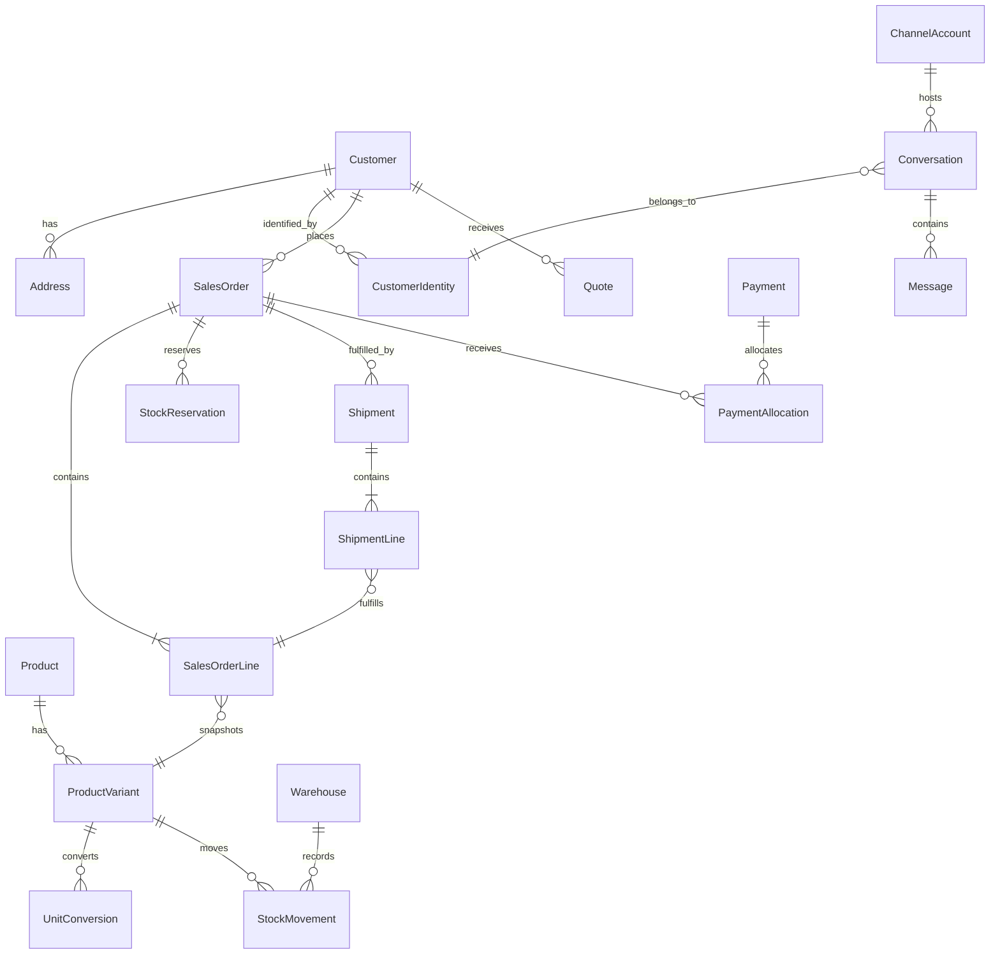

# Mô hình dữ liệu đích ở mức khung

## Bổ sung Facebook backfill 2026-10-13

`IntegrationJob(kind=BACKFILL)` tái sử dụng queue/lease hiện hành. `payload` là checkpoint có dataset, khoảng UTC `[since,until)`, `rootAfter`, stack task/cursor và tiến độ/page budget; tuyệt đối không chứa Page token, `paging.next` hoặc raw Graph body. Unique `(connectionId,idempotencyKey)` khóa double-click cùng phạm vi. `ConversationMessage.importJobId` và `SocialComment.importJobId` nullable (migration `20261012010000_facebook_backfill_provenance`) đánh dấu nguồn lịch sử; webhook mới để null. Unique `(connectionId,externalMessageId)`/`(connectionId,externalCommentId)` chống trùng giữa backfill, webhook và reconnect. Backfill chỉ insert-missing, không đổi unread/note/assignment/trạng thái comment cũ; conversation `lastMessageAt` chỉ tăng.

## Bổ sung schema đồng bộ đa kênh (migration 20261008230000)

`IntegrationConnection.capabilities.authorization=VERIFIED` là điều kiện binding đã được xác minh qua luồng cấp quyền; external account ID thủ công không đủ. `CONNECTED` không được suy ra chỉ từ việc nhận signed webhook. Migration `20261009120000_channel_auth_attempts` dùng chung cho Facebook và Zalo OA: `IntegrationAuthAttempt` lưu state SHA-256, actor/business/provider, redirect URI, expiry, trạng thái claim một lần, account list không chứa token và grant mã hóa tạm thời. Facebook finalize thay credential ciphertext sau Page subscription readback; Zalo lưu PKCE verifier mã hóa khi pending, đổi code/xác minh OA metadata rồi lưu access/refresh token mã hóa và expiry. Cả hai reconnect giữ nguyên connection/history; Zalo worker xoay token trong DB lock. Xem [`tasks/CHANNEL-AUTH-01.md`](tasks/CHANNEL-AUTH-01.md).

`IntegrationConnection` ghi provider/account/capabilities/status; `IntegrationJob` là durable inbox + DB worker queue (external event key, attempts, lease, retry time, safe error code). `ExternalCustomerIdentity`, `Conversation`, `ConversationMessage`, `InternalConversationNote` và `SocialComment` tách đúng định danh/tin nhắn/bình luận/note. `ExternalOrder`/`ExternalOrderLine` là vùng staging chỉ đọc; `ExternalProductMapping` ánh xạ external product/model sang `ProductVariant` và hệ số quy đổi. `AdminAlert` hỗ trợ external order, nullable `orderId`, và `dedupeKey` unique.

`SocialTicket` là hồ sơ xử lý nội bộ gắn đúng một `Conversation` hoặc `SocialComment`, cùng business được service kiểm tra và SQL CHECK bảo vệ. Có `kind`, `priority`, `status`, `labels`, `assignedStaffId`, `sourceUrl` snapshot cho comment, `requestKey` unique theo business và `version` để chống ghi đè. `SocialTicketEvent` lưu actor, thời điểm UTC và nội dung đổi trong cùng transaction; không tạo Customer hoặc đơn từ ticket. Migration additive `20261014010000_social_tickets`.

Không có quan hệ tự ghi stock, payment, receivable, revenue hoặc SalesOrder từ ExternalOrder. Link customer/SKU là thao tác riêng có kiểm tra `businessId`; không tự merge customer. Facebook/Zalo credential dùng AES-256-GCM với khóa cấu hình backend bền vững và context theo business/account/attempt; không lưu token thô hoặc trả token ra API/UI. Disconnect local xóa ciphertext, không xóa history.

Schema đã được migration tăng dần qua lát cắt 05B. Mỗi đợt chỉ thêm phần cần cho lát cắt đang làm, nhưng khóa và ranh giới module phải phù hợp mô hình đích dưới đây.

## 1. Quy ước chung

### Hồ sơ khách hàng 360°

- `CustomerNote` (`customer_notes`) lưu ghi chú nội bộ append-only theo business/customer/author/time; migration tăng dần `20261008240000_customer_profile_360`. Tạo ghi chú và audit log cùng transaction; không lưu nội dung nhạy cảm trùng trong audit metadata.
- Migration `20261008250000_social_identity_01` bổ sung `CustomerStatus.MERGED`/`mergedIntoId` redirect, `ExternalCustomerIdentity.linkedById/version`, `CustomerDuplicateSuggestion` (business pair key, evidence fingerprint/status/decision) và `CustomerMergeCommand` (idempotency key/hash/response). Source Customer được giữ để truy xuất; merge chuyển FK quan hệ trong transaction, không sửa snapshot chứng từ.
- `CustomerDuplicateSuggestion` hiện lưu Customer A–B. Không có identity-to-Customer auto-suggestion khi social identity thiếu contact đã xác minh; tên hiển thị social không được dùng độc lập làm bằng chứng. Customer merge giữ profile/consent từ target, lưu contact không trùng theo type + normalized value và chặn khác owner hoặc hai số dư tín dụng cùng tồn tại.
- Timeline là hợp nhất đọc từ CustomerNote, CustomerTask, SalesOpportunity, Quote và SalesOrder; chưa tạo bảng projection/event store. Mỗi event giữ source ID, timestamp tạo và trạng thái/giá trị snapshot hiện tại của module nguồn. Không tự dựng lịch sử đã gửi/giao hoặc số lần mua từ dữ liệu snapshot.
- Phân quyền từng nguồn trước khi truy vấn; quote/order totals chỉ trả theo `quotes.read`/`orders.read`; phiếu thu chỉ trả theo `receivables.view`. Không có projection “đã mua” hoặc doanh thu trong hồ sơ 360°.

- ID nội bộ không mang ý nghĩa nghiệp vụ; mã hiển thị (`order_no`, `sku`) có unique constraint riêng.
- Tất cả bảng nghiệp vụ có `created_at`, `updated_at` theo UTC; chứng từ đã chốt ưu tiên event/adjustment thay vì sửa mất lịch sử.
- Tiền VND là integer/bigint; số lượng và hệ số là Decimal với precision được chốt khi biết ngành hàng.
- Bản ghi thuộc một đơn vị kinh doanh; thiết kế ban đầu chỉ có một đơn vị nhưng không dùng hằng số ngầm trong logic quyền.
- Trường trạng thái dùng enum/constraint và transition service, không cho cập nhật tùy ý.
- PII và credential tách khỏi dữ liệu hiển thị; credential mã hóa và không bao giờ trả về API.

## 2. Quyền sở hữu theo module

| Module       | Sở hữu                                                                                            | Không được tự thay                           |
| ------------ | ------------------------------------------------------------------------------------------------- | -------------------------------------------- |
| Identity     | StaffUser, Role, Permission, Session                                                              | Chứng từ bán/kho/tiền                        |
| Customer     | Customer, ContactPoint, Address, CustomerIdentity, CustomerGroup, Task                            | Snapshot địa chỉ trên đơn cũ                 |
| Catalog      | Product, ProductVariant, UnitConversion, MediaAsset                                               | StockBalance, giá chốt trên đơn              |
| Pricing      | PriceList, PriceRule, CustomerPriceAssignment                                                     | Tổng đơn đã chốt                             |
| Quoting      | Quote, QuoteLine, QuoteRevision                                                                   | Reservation/StockMovement                    |
| Inventory    | Warehouse, StockBalance, StockMovement, StockReservation, StockAdjustment                         | Yêu cầu mua, khoản phải trả                  |
| Purchasing   | Supplier, PurchaseOrder/Line, GoodsReceipt/Line                                                   | Sổ tiền; nhận hàng gọi inventory transaction |
| Ordering     | SalesOrder/Line, OrderEvent                                                                       | Stock ledger và payment ledger trực tiếp     |
| Fulfillment  | Shipment/Line, TrackingEvent, ReturnRequest/Line/Receipt                                          | Tự ghi nhận COD đã về                        |
| Finance      | Payment, PaymentAllocation, Refund, Expense, ReceivableDocument, PayableDocument, SettlementEntry | Sửa dòng đơn/kho để khớp số                  |
| Messaging    | ChannelAccount, Conversation, Message, Assignment                                                 | Tự xác nhận đơn từ nội dung chat             |
| Integration  | ChannelListing, ExternalOrderLink, WebhookEvent, SyncJob, OutboxEvent, IntegrationCredential      | Logic nghiệp vụ bản sao                      |
| Customer web | CustomerAccount, OtpChallenge, Cart                                                               | Cấp nhóm sỉ/nợ từ đăng ký                    |
| Marketing/AI | Campaign, ContentItem, ConsentRecord, KnowledgeDocument, AiRun/Suggestion/Feedback                | Tạo tiền/kho không qua API nghiệp vụ         |

## 3. Quan hệ trung tâm

## 4. Aggregate và khóa cạnh tranh

### Inventory aggregate

- Khóa logic: `business_id + warehouse_id + variant_id`.
- `StockMovement` là sổ; `StockBalance` là projection/tổng hợp có version để cập nhật optimistic hoặc row lock trong transaction.
- `StockReservationEvent` là ledger bất biến `RESERVED`/`RELEASED` theo đơn/dòng/kho/SKU; unique `(business_id, event_key)`. `StockBalance.reservedQuantity` là projection cập nhật cùng transaction; đối chiếu projection với tổng event.
- Xác nhận và xuất đơn phải khóa đúng các balance theo thứ tự ổn định để tránh deadlock.

### Sales order aggregate

- Header lưu khách, nguồn, currency, snapshot địa chỉ, tổng do backend tính và ba nhóm trạng thái: vòng đời, giao, thanh toán.
- Line lưu SKU/name/UOM/conversion/price/discount snapshots và số đặt/giao/trả.
- `OrderEvent` lưu transition và idempotency key; sửa sau chốt qua command có version.

### Payment aggregate

- `Payment` là khoản tiền thực nhận/chi với external reference unique theo provider/account.
- `PaymentAllocation` phân bổ tới receivable/order; tổng allocation không vượt payment.
- Phần chưa phân bổ là tiền khách trả trước/trả thừa, không phải nợ âm.

## 5. Unique và constraint dự kiến

| Dữ liệu                | Constraint tối thiểu                                                 |
| ---------------------- | -------------------------------------------------------------------- |
| SKU                    | unique trong đơn vị kinh doanh, so sánh theo chuẩn đã chốt           |
| Định danh kênh         | unique `(channel_account_id, external_user_id)`                      |
| Sự kiện ngoài          | unique `(channel_account_id, external_event_id)`                     |
| Đơn ngoài              | unique `(channel_account_id/shop_id, external_order_id)`             |
| Idempotency API        | unique `(actor/client, operation, idempotency_key)` với request hash |
| Reservation nguồn      | unique `(source_type, source_line_id, active version)`               |
| Mã thanh toán provider | unique `(provider_account_id, external_transaction_id)`              |
| Quy đổi                | hệ số > 0; một base unit/SKU; version không chồng hiệu lực           |
| Số lượng chứng từ      | >= 0; transition kiểm tra giới hạn theo nghiệp vụ                    |

## 6. Projection và đối chiếu

`StockBalance`, số phải thu và dashboard là projection để đọc nhanh, không thay sổ. Cần job/báo cáo đối chiếu:

- Tổng stock movements theo SKU/kho với balance.
- Tổng receivable documents, allocations, credit adjustments với số còn phải thu.
- Tổng shipment/return lines với số đã giao/đã trả trên order line.
- Tổng payment với allocations/refunds và phần chưa phân bổ.

Sai lệch tạo cảnh báo và quy trình sửa có chứng từ; không “fix” bằng update trực tiếp.

## 7. Migration theo đợt

- Đợt 01: business, staff identity, role/permission/session, audit.
- Đợt 02: customer/contact/address/group/task.
- Migration Đợt 02 đã triển khai `Customer`, `ContactPoint`, `Address`, `CustomerGroup`, `CustomerTask` và `SalesOpportunity`; trùng liên hệ được phép giữa các customer để chỉ gợi ý, không tự gộp.
- Quy tắc nguồn kênh 2026-10-08 không cần migration: `Customer.source` tiếp tục lưu nguồn khai báo (nhận diện không phân biệt hoa/thường cho Facebook/Messenger, Zalo, Shopee, TikTok Shop); `Customer.groupId` vẫn tham chiếu `CustomerGroup`, nhưng backend suy ra nhóm sỉ/lẻ từ các nền tảng đã chốt. Không tự chuyển nhóm với nguồn khác/chưa rõ.
- Đợt 03: product/variant/unit conversion/media metadata.
- Migration Đợt 03 đã triển khai `Product`, `ProductVariant`, `UnitConversion` và `MediaAsset`; SKU/barcode có unique theo business, factor có check dương, mọi trạng thái dùng ngừng bán/lưu trữ thay cho xóa.
- Migration `20261029120000_catalog_product_import` thêm `ProductImportCommand` để lưu request hash/response chống gửi trùng. Import tạo catalog, variant, metadata ảnh và audit trong một transaction; không tạo `PriceTier`, stock balance, movement hoặc chuyển đổi đơn vị.
- Migration Đợt 04A đã triển khai `Supplier`, `PurchaseOrder`, `PurchaseOrderLine`; dòng đơn mua snapshot SKU/đơn vị/hệ số/số lượng cơ sở, có DB check dương và không có quan hệ nào tự ghi tồn.
- Migration Đợt 04B đã triển khai `Warehouse`, `GoodsReceipt/Line`, `StockBalance`, `StockMovement`; phiếu nhận có request hash/idempotency key, dòng snapshot và DB check không âm/dương theo bất biến.
- Migration Đợt 04C-A đã triển khai `OpeningStock` với snapshot SKU/tên/đơn vị, giá trị, thời điểm, người tạo, request hash/idempotency key và unique theo business/kho/SKU. `StockMovement` nhận nguồn `OPENING_STOCK`; chứng từ, balance và movement được ghi trong một transaction Serializable. Migration snapshot tiếp nối có backfill trước khi đặt NOT NULL.
- Migration Đợt 04C-B thêm `StockAdjustment` một SKU/chứng từ, trạng thái `POSTED`, lưu tồn hệ thống, số đếm, chênh lệch, lý do, người tạo, snapshot danh mục, request hash/idempotency key và thông tin định giá. `StockMovement` nhận nguồn `STOCK_ADJUSTMENT` và chênh lệch có dấu. Balance, chứng từ, movement và audit đổi cùng một transaction; `version` chặn kiểm đếm cũ.
- Migration Đợt 05A thêm `PriceTier` lưu giá admin theo business/SKU/bậc số lượng, số VND nguyên, version và unique `(business_id, variant_id, quantity_from)`. `PriceTierCommand` lưu idempotency key, request hash và response của lệnh ghi giá để retry an toàn. Phần mở rộng 05A thêm đơn vị bán cố định, giá lẻ và resolver lượng Decimal. Giá bậc trống không tự sinh giá.
- Cập nhật 05A: `ProductVariant` có `sellingUnitCode`, `sellingUnitName`, `sellingUnitFactor` cố định; migration cũ backfill đơn vị gốc. `PriceTier.quantityFrom=1` biểu thị giá lẻ; các bậc sỉ giữ mốc 5, 10, 15...; số lượng giao dịch được nhận dưới dạng Decimal tối đa 6 chữ số lẻ.
- Đợt 05B thêm `Quote`, `QuoteLine`, `QuoteRevision`, `QuoteCommand`: draft lưu snapshot sản phẩm/đơn vị/giá admin theo SKU, giảm dòng/toàn báo giá, phí giao, thuế theo phần trăm hoặc VND, cọc dự kiến, tổng VND, ghi chú thanh toán và version. Lệnh ghi chống trùng bằng request hash; cập nhật nháp dùng optimistic version. Revision lưu JSON snapshot bất biến cùng sent/received/expiry UTC; 72 giờ tính từ lúc khách nhận. Chính sách thuế đã chốt ngày 2026-10-07: một cách thuế mỗi báo giá, phần trăm trên tiền hàng sau giảm cộng phí giao, không gồm cọc.
- Đợt 05C thêm `SalesOrder`/`SalesOrderLine` chỉ ở trạng thái `DRAFT`, liên kết một-một với báo giá nguồn, cùng snapshot dòng/chi phí/thuế/cọc và revision nguồn. `AdminAlert` lưu thông báo nội bộ cho nhân viên có `staff.manage`, có trạng thái đã đọc; tạo đơn, đổi báo giá thành `ACCEPTED`, alert, audit và `QuoteCommand` cùng transaction. Khi đó chưa tạo reservation, payment, receivable hoặc shipment.
- Đợt 06 mở rộng vòng đời đơn (đọc/list, xác nhận, hủy), reservation và shipment; queue tác nghiệp kho đọc shipment/đơn đã xác nhận trong business theo quyền riêng, còn COD và giao từng phần không hỗ trợ.
- 06A mở rộng `SalesOrder` cho nguồn báo giá tùy chọn (đơn nhập tay có `sourceQuoteId = null`, `sourceRevision = 0`) và thêm `OrderCommand` để lưu idempotency key, request hash, response. Đơn nháp nhập tay snapshot SKU/đơn vị/giá đã phân giải theo bảng giá trong backend; tạo `AdminAlert` nội bộ cho staff có `staff.manage`; không có giảm giá, phí, thuế, cọc; không ghi kho/công nợ/thanh toán. Đọc/list vẫn giới hạn theo business.
- Migration 06B thêm `StockReservationEvent` ledger append-only và trạng thái `SalesOrder.CANCELED`. Chuyển quote giữ tồn tại thời điểm khách chấp nhận; transaction ghi đơn/dòng, projection balance, event, quote, alert, audit và idempotency. Hủy đơn nháp ghi event release và giảm reserved cùng transaction. Hold không tự hết hạn.
- Migration 07A thêm `PaymentReceipt`, `PaymentAllocation`, `Receivable`, `ReceivableSettlement`, `CustomerCreditBalance` và append-only `CustomerCreditEvent`. Thu nhiều lần/thu một phần được ghi trước xác nhận; allocation chọn tường minh; phần thừa thành customer credit.
- Migration 07B thêm `CustomerCreditApplication`, event `APPLICATION/REVERSAL` và settlement source tùy chọn. Số dư chỉ được dùng tường minh cho đơn nháp cùng khách, khóa theo business/version và chống trùng; xác nhận ghi settlement từ phiếu thu và application. Hủy đơn nháp không có thu tiền mặt đảo application và phục hồi số dư. Refund tiền mặt, chi phí và màn hình danh sách công nợ chưa triển khai.
- Migration 06D thêm `Shipment` một-một với đơn và `ShipmentLine` snapshot lượng/giá vốn; `StockMovement` nhận nguồn `SALE_SHIPMENT`. Tạo shipment chỉ từ đơn đã xác nhận và giữ đủ hàng; cùng transaction trừ `onHand` và `reserved`, ghi giá vốn bình quân, ledger, audit/idempotency. Đánh dấu giao đủ ở lệnh riêng mới ghi nhận doanh thu hàng hóa (không gồm phí giao/thuế). Không nhận giao thiếu hoặc tạo COD receipt.
- Hàng trả chỉ tăng tồn khả dụng sau kiểm tra chất lượng; hàng lỗi đưa vào tồn chờ xử lý. Thời hạn nhận trả chưa có số ngày, nên validation Đợt 08 chưa khóa thời hạn.
- 08A thêm cấu hình `Business.returnWindowDays` nullable/version; `ReturnRequest` snapshot deliveredAt, deadlineAt và policyDays; `ReturnLine` lưu lượng theo đơn vị bán + đơn vị gốc và giá vốn shipment; `ReturnInspection` lưu phân loại; `ReturnCommand` chống lặp. Khi chưa cấu hình ngày thì không nhận trả.
- Cập nhật sau bullet lịch sử 07B: danh sách công nợ đã triển khai; `GET /receivables` là projection đọc trên `Receivable.balanceVnd` và tổng settlements; không tạo ledger hoặc tự phân bổ. Phần mô tả 08A ở bullet kế tiếp là trạng thái mới hơn phần kế hoạch cũ.
- QA cập nhật `StockBalance.onHandQuantity` theo toàn bộ hàng nhận và `unavailableQuantity` theo lượng lỗi; ghi positive `StockMovementType.CUSTOMER_RETURN` gắn duy nhất với ReturnLine. WAC dùng giá vốn dòng shipment gốc. Không ghi giao dịch tiền/doanh thu trong 08A.
- 08B tổng hợp `Shipment.recognizedRevenueVnd` theo tháng địa phương và `ShipmentLine.baseQuantity` theo SKU; truy vấn chỉ lấy shipment `DELIVERED` và `businessId` phiên hiện tại. Gross trước trả là nhãn rõ ràng; không suy ra doanh thu net từ return requests.
- Đợt 07B–09: phân bổ số dư khách hàng/hoàn tiền/chi phí; returns/QA/reporting; Facebook connector vẫn chưa triển khai. COD đối soát cũng chờ giải quyết xung đột BR-COD-01 và BR-AR-02.
- Chỉ thêm integration/AI/customer-web entities khi bắt đầu đúng đợt tương ứng.

### 2026-10-15 — outbound social

SocialOutbound lưu ý định gửi theo businessId, connectionId, đúng một trong conversationId/commentId, actorId, requestKey, kind, body, trạng thái, providerObjectId, thời điểm thử/chấp nhận và mã lỗi. Unique (businessId, requestKey) và (connectionId, providerObjectId) khi có ID chặn phát lại/trùng nguồn. UNKNOWN là kết quả không xác định, cần đối soát bằng provider ID/echo trước mọi quyết định gửi lại. Bản tin OUTBOUND_ECHO cùng provider mid chỉ có một dòng; bình luận reply giữ externalParentId gốc và không gán PSID Messenger cho tác giả.

### Nguồn báo giá từ hội thoại (2026-10-15)

`Quote.sourceConversationId`, `sourceMessageId`, `sourceTicketId` là FK nullable, `ON DELETE RESTRICT`, có index. Báo giá cũ giữ cả ba giá trị null. Khi tạo, service kiểm business, Customer đã liên kết với identity, và tin/phiếu thuộc đúng hội thoại trong một transaction; nguồn không được đổi khi sửa draft. `SalesOrder.sourceQuoteId` hiện có là chuỗi nguồn bền vững từ đơn → báo giá → hội thoại/tin/phiếu. Không sao chép nội dung tin khách vào đơn.
# Bổ sung 2026-10-16 — quyền nhân viên theo tài khoản kênh

`IntegrationStaffAccess` gắn một `StaffUser` với một `IntegrationConnection` trong cùng business, unique `(connectionId, staffId)`. `canRead` quyết định xem connection, hộp thư, bình luận, ticket và đơn ngoài của tài khoản đó; `canSend` chỉ có ý nghĩa khi `canRead=true` và vai trò có quyền gửi. Thu hồi xóa grant, không xóa dữ liệu nguồn. Quản trị viên có `connectors.manage` quản lý toàn bộ connection của business. Migration additive `20261016010000_integration_staff_access` chỉ được áp trên DB scratch ở checkpoint này.
